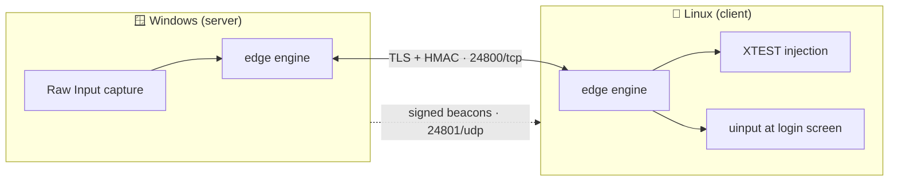

<div align="center">

# 🖱️ mouse-rs

**One keyboard. One mouse. Two computers.**

Move your pointer off the edge of your Windows screen and keep working on Linux.<br>
Your keyboard follows, and so does your clipboard.

    

[Install](#-install) · [Connect the two computers](#-connect-the-two-computers) · [Update](#-update) · [Report a problem](#-report-a-problem) · [Troubleshooting](#-troubleshooting) · [For developers](#-for-developers)

</div>

---

## ✨ What you get

| | |
|---|---|
| 🖱️ **Keyboard and mouse sharing** | Push the pointer past the screen edge and it lands on the other computer. Tracking is 1:1, and corners are reachable. |
| 📋 **Shared clipboard** | Copy text, images, files or whole folders on one computer and paste them on the other. |
| 🔐 **Log in from the other computer** | Type your Linux login password from the Windows keyboard, before anyone has logged in. |
| 🌐 **Any network** | Cable, home router, Wi-Fi or a phone hotspot. If you unplug the cable, it switches to Wi-Fi within moments, and switches back when you plug it in. |
| 🔁 **Reconnects by itself** | Restart either computer and sharing comes back without a click. |
| 🛡️ **Private by design** | Everything between the two computers is encrypted, and only computers with your shared secret can connect. |
| 🆘 **Always a way back** | Press **Scroll Lock** to take control back, even if the network drops. |

---

## 📦 Install

You need **one Windows computer** and **one Linux computer** on the same network. Install
mouse-rs on both. It takes about two minutes per computer, and nothing needs a reboot.

### 🪟 Windows

1. Download **`mouse-rs-<version>-windows-x86_64.zip`** from the [Releases](../../releases) page.
2. Extract it anywhere, for example to `C:\Program Files\mouse-rs`.
3. Double-click **`mouse-rs.exe`**.
4. When Windows Firewall asks, tick **Private networks** and click **Allow access**. If you
   will also use a phone hotspot or public Wi-Fi, tick **Public networks** too.

The control panel opens, and a mouse-rs icon appears in the tray, next to the clock.

> 💡 **Tip:** if a window running as administrator (Task Manager, an installer) has focus,
> Windows blocks the pointer from crossing. The panel tells you when this happens, and can
> start mouse-rs elevated so it doesn't.

### 🐧 Linux

1. Download **`mouse-rs-<version>-linux-x86_64.tar.gz`** from the [Releases](../../releases) page.
2. Extract it and start it:
   ```sh
   tar xzf mouse-rs-*-linux-x86_64.tar.gz
   cd mouse-rs-*-linux-x86_64
   ./run-gui.sh
   ```
3. If it says a library is missing, install the two desktop libraries it uses (one time
   only), then run it again:
   ```sh
   sudo apt install libgtk-3-0 libayatana-appindicator3-1
   ```

The control panel opens, and the icon appears in your panel's system tray.

> ℹ️ Linux needs an **X11** session. Most desktops (Xfce, MATE, KDE on X11, Kali's default)
> use it. Wayland sessions aren't supported yet.

---

## 🔗 Connect the two computers

You do this once. Afterwards, mouse-rs connects by itself every time.

**1. Choose which computer owns the keyboard and mouse.** That one is the **server**; the
other is the **client**. Usually the server is the laptop whose keyboard you type on.

| On the… | Set **Role** to |
|---|---|
| Computer with the keyboard and mouse you use | **Server** |
| The other computer | **Client** |

**2. Give both the same secret.** On the server, open **Security** and click
**Generate**, then **Show**. Copy it, and paste it into **Security** on the client.

**3. Tell each one where the other screen is.** If Linux sits to the *left* of the laptop,
set the laptop's exit edge to **left**. The panel only shows the edges each role uses.

**4. Click Start on both.** The panel turns green and names the other computer. Push the
pointer off the edge and it appears on the other screen.

**5. Make it automatic.** In the **Startup** tab, turn on **Start at login** and
**Auto-connect on launch** on both computers. From now on, sharing starts as soon as you log in.

> 🔎 You don't need to type an IP address. The server announces itself on every network it's
> on, and the client finds it, even after the network changes.

### Optional: type your Linux password from Windows

In the Linux panel's **Startup** tab, turn on **Share input at the login screen**. Linux asks for your
password **once** to install a small system service. After the next reboot, move the
pointer onto the Linux screen at the login prompt and type your password on the Windows
keyboard. The Windows panel tells you when Linux is waiting at its login screen.

---

## 🔄 Update

Your settings live outside the program folder, so updating never loses them:
`%USERPROFILE%\.mouse_share\` on Windows, `~/.mouse_share/` on Linux.

### 🪟 Windows

1. Right-click the tray icon and choose **Quit**.
2. Download the new zip from [Releases](../../releases) and extract it over the old folder.
3. Run **`mouse-rs.exe`**. It reconnects by itself.

### 🐧 Linux

1. Choose **Quit** from the tray icon.
2. Extract the new tarball over the old folder.
3. Run **`./run-gui.sh`**.
4. If you use the login-screen option, turn **Share input at the login screen** off and on
   again in the panel. That refreshes the system service's copy. The panel warns you
   when it's out of date.

> ✅ **Update both computers to the same version.** An older version still connects to a
> newer one, but new features need both sides.

---

## 🐞 Report a problem

Every computer keeps a log of what mouse-rs did. Send it with your report:

| Computer | Log file |
|---|---|
| Windows | `%USERPROFILE%\.mouse_share\mouse-rs.log` (paste the path into Explorer's address bar) |
| Linux | `~/.mouse_share/mouse-rs.log` |
| Linux login screen | `/var/lib/mouse-rs/.mouse_share/mouse-rs.log` |

Please include:

1. **What you did**, and **what happened instead**.
2. **Roughly when.** The log is timestamped, so "around 14:20" helps a lot.
3. **The log files from both computers.**

The logs never contain your shared secret, and never contain what you type at the login
screen.

---

## 🧰 Troubleshooting

| Symptom | Try this |
|---|---|
| Panel says **Connecting…** forever | Both computers must be on the same network, and some guest Wi-Fi and hotspots block devices from seeing each other. On Windows, allow mouse-rs in Windows Firewall for that network type. |
| **Authentication failed** | The shared secrets differ. Copy it again from the server to the client. |
| The pointer won't cross | Check the exit edge matches where the other screen physically is. On Windows, an administrator window might have focus (see the tip under Install). |
| A key seems stuck | Press and release it once on the computer you're typing on. **Scroll Lock** always returns control. |
| Linux says a library is missing | `sudo apt install libgtk-3-0 libayatana-appindicator3-1` |
| Login screen doesn't respond | Wait for the Windows notification, move the pointer inward a little, then across the edge. In the Linux panel, check the login-screen line says it's up to date. |

Known issues, with their status, are listed in [docs/KNOWN-ISSUES.md](docs/KNOWN-ISSUES.md).

---

## 🗺️ Making it one-click

The goal: **download, run, done**, on both computers, with updates that take care of
themselves. This is where each step stands today.

| Step | Today | Goal |
|---|---|---|
| Get the program | Zip / tarball from Releases | ✅ Same, plus a Windows installer and a Linux `.deb` / AppImage |
| Windows firewall | One "Allow access" click | 🛠 Installer adds the rule, so there's no prompt |
| Linux libraries | Possibly one `apt install` | 🛠 Declared by the `.deb`, or bundled in an AppImage, so there's nothing to install |
| Pair the computers | Copy a 32-character secret | 🛠 Show a **6-digit pairing code** on one, type it on the other |
| Choose role and edges | Pick in the panel | 🛠 Guess the role from which computer moved its mouse, and confirm the edge with one push |
| Updates | Download and replace by hand | 🛠 **Update button**: checks for a new version, downloads it, verifies its signature, restarts itself, and updates the other computer too |
| Login-screen service after an update | Toggle off and on | 🛠 Refreshed automatically by the update |
| Bug reports | Find and send log files | 🛠 **Report a problem** button: collects both computers' logs into one file |
| Downloads for customers | Private repository | 🛠 A public download page or releases repository, since a private repo's releases can't be downloaded by customers |

---

## 👩‍💻 For developers

<details>
<summary><b>Build and test</b></summary>

```sh
cargo build --release                                   # Linux: target/release/mouse-rs
cargo build --release --target x86_64-pc-windows-gnu    # Windows exe, cross-compiled
cargo test --workspace                                  # 227 tests
cargo clippy --workspace --all-targets                  # lint (also with --target x86_64-pc-windows-gnu)
bash scripts/package.sh                                 # release zip + tarball + SHA256SUMS in dist/
```

The Linux GUI links `libxdo`. `crates/mouse/build.rs` points the linker at the tracked
`.buildlibs/libxdo.so`, so a plain `cargo build` works without `libxdo-dev`. See
[docs/PACKAGING.md](docs/PACKAGING.md) for cross-compiling.

</details>

<details>
<summary><b>Command line</b></summary>

```sh
mouse-rs                    # control panel (default)
mouse-rs server             # headless server
mouse-rs client             # headless client
sudo mouse-rs greeter-install     # install / refresh the login-screen service
mouse-rs greeter-status           # check it (no sudo)
sudo mouse-rs greeter-uninstall   # remove it
```

</details>

<details>
<summary><b>Configuration</b></summary>

`~/.mouse_share/config.json` (Windows: `%USERPROFILE%\.mouse_share\config.json`). It's
written by the panel with mode `0600`; [config.example.json](config.example.json) lists
every field.

| Field | Meaning |
|---|---|
| `name` | This computer's display name |
| `role` | `server` or `client` |
| `shared_secret` | Identical on both computers. Never commit a real one. |
| `server_host` / `server_port` | Client: first address to try. Beacons find the server if it's wrong. |
| `exit_edge` / `entry_edge` | Which screen edge leads to the other computer |
| `discovery_port` | UDP port for beacons (default 24801) |
| `log_upload_url` | Optional collector that receives this computer's log |

Ports: **24800/TCP** (input, clipboard, files) and **24801/UDP** (discovery). See
[docs/NETWORKING.md](docs/NETWORKING.md).

</details>

<details>
<summary><b>How it's built</b></summary>



```
crates/
  mouse-core/       config, protocol, HMAC auth, TLS link, heartbeat, beacons, network watcher, bulk lane
  mouse-input/      capture/injection: X11/XTEST, uinput, Windows Raw Input + SendInput
  mouse-engine/     edge-crossing state machine, link status
  mouse-clipboard/  text, image, file and folder sync, history, file holder
  mouse/            binary: CLI, iced panel, tray, notifications, login-screen service, log shipping
```

Input hooks run on their own native threads and talk to the async (tokio) network core over
channels, so a stuck hook can never freeze the link, and Stop never hangs.

</details>

<details>
<summary><b>Documentation and status</b></summary>

- [docs/README.md](docs/README.md): index of every document
- [docs/KNOWN-ISSUES.md](docs/KNOWN-ISSUES.md): bug list (B1…) with evidence
- [docs/UI-REQUIREMENTS.md](docs/UI-REQUIREMENTS.md): agreed panel behaviour (R1…)
- [CHANGELOG.md](CHANGELOG.md): what changed, by date

Proven on hardware as of 13 October 2026: link, input on both platforms, reconnect, panel
and tray, start at login, text clipboard, discovery, cable ↔ Wi-Fi failover, typing the
password at the Linux login screen. Still to be tested by hand: file copy end to end,
files pasteable after quitting, and the Windows file toast.

</details>

---

<div align="center">

**Proprietary software.** Copyright © 2026 Prashant Pal. All rights reserved. See [LICENSE](LICENSE).<br>
Built on open-source crates under permissive licences (MIT, Apache-2.0); their notices ship with every release.

</div>
