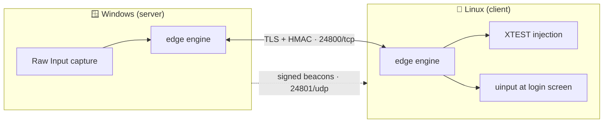

<div align="center">

# 🖱️ mouse-rs

**One keyboard. One mouse. All your computers.**

Move your pointer off the edge of your Windows screen and keep working on Linux.<br>
Your keyboard follows, and so does your clipboard.

    

[Install](#-install) · [Connect your computers](#-connect-your-computers) · [Update](#-update) · [Report a problem](#-report-a-problem) · [Troubleshooting](#-troubleshooting) · [For developers](#-for-developers)

</div>

---

## ✨ What you get

| | |
|---|---|
| 🖱️ **Keyboard and mouse sharing** | Push the pointer past the screen edge and it lands on the other computer. Tracking is 1:1, and corners are reachable. |
| 🖥️ **Several computers at once** | Stay connected to all of them, and jump between them with **Ctrl+Alt+Shift+1, 2, 3…** or one click. |
| 📋 **One clipboard for all** | Copy text, images, files or whole folders on one computer and paste them on another. |
| 🔢 **Pair with a 6-digit code** | Like pairing a Bluetooth device: one shows a code, the other types it. Each pairing gets its own key. |
| 🔐 **Connection PIN and login screen** | Optionally ask for a PIN before a computer can be controlled, and type your Linux login password from the other keyboard. |
| 🌐 **Any network** | Cable, home router or Wi-Fi. No IP addresses to type: the computers find each other, even after the network changes. |
| 🔄 **Updates inside the app** | **About › Check now › Update now**. Every update is signed and checked before it runs. |
| 🆘 **Always a way back** | Press **Scroll Lock** to take control back, even if the network drops. |

---

## 📦 Install

Install mouse-rs on every computer you want to share between. Windows and Linux can be
mixed in any combination. It takes about a minute per computer, and nothing needs a reboot.

### 🪟 Windows 10 and 11

1. Download **`mouse-rs-<version>-windows-x86_64.zip`** from the [Releases](../../releases/latest) page.
2. Extract it anywhere, for example to your Documents folder, and double-click **`mouse-rs.exe`**.
3. Windows may say **"Windows protected your PC"** the first time, because mouse-rs is new
   and not yet code-signed. Click **More info**, then **Run anyway**.
4. When Windows Firewall asks, tick **Private networks** and click **Allow access**.

### 🐧 Linux (X11 desktops)

1. Download **`mouse-rs-<version>-linux-x86_64.tar.gz`** from the [Releases](../../releases/latest) page.
2. Extract it and start it:
   ```sh
   tar xzf mouse-rs-*-linux-x86_64.tar.gz
   cd mouse-rs-*-linux-x86_64
   ./run.sh
   ```
3. If it says a library is missing, install these once, then run it again:
   ```sh
   sudo apt install libgtk-3-0 libayatana-appindicator3-1
   ```

> ℹ️ Linux needs an **X11** session. Most desktops (Xfce, MATE, KDE on X11, Kali's default)
> offer one. Wayland sessions aren't supported yet.

---

## 🔗 Connect your computers

You do this once per computer. Afterwards mouse-rs connects by itself whenever it starts.

1. On the computer whose keyboard and mouse you use, choose **Shares its mouse**.
2. On each other computer, choose **Is controlled**.
3. On the computer that shares its mouse, press **Pair a new device**. A 6-digit code appears.
4. Type that code into the other computer's mouse-rs window and press **Pair**.

That's all. Push the pointer off the edge of the screen and it appears on the other
computer. To pair a third computer, repeat steps 2–4. Switch between them with
**Ctrl+Alt+Shift+number**, or **Use** on the main window.

**Optional:**
- **Settings › Startup › Start at login**, so mouse-rs is running whenever you are.
- **Settings › Screens & edges**: click the edge where the other screen sits.
- **Settings › Security & pairing**: set a connection PIN on a computer that is controlled.
- **Type your Linux login password from the other keyboard:** on Linux, turn on
  **Settings › Startup › Share input at the login screen**. It asks for your password once to
  install a small system service.

---

## 🔄 Update

mouse-rs checks for a new version each time it starts. When one is available, a banner
says so. Click **Update now**, then **Restart mouse-rs**. You can also check yourself:
**⋯ › Settings › About › Check now**.

Your settings and pairings are kept: they live in `%USERPROFILE%\.mouse_share\` on
Windows and `~/.mouse_share/` on Linux, outside the program folder.

---

## 🐞 Report a problem

Every computer keeps a log of what mouse-rs did (**Settings › Diagnostics** shows where).
Send it with your report:

| Computer | Log file |
|---|---|
| Windows | `%USERPROFILE%\.mouse_share\mouse-rs.log` |
| Linux | `~/.mouse_share/mouse-rs.log` |
| Linux login screen | `/var/lib/mouse-rs/.mouse_share/mouse-rs.log` |

Please include what you did, what happened instead, roughly when (the log is
timestamped), and the logs from both computers. The logs never contain your pairing keys
or what you type at the login screen.

---

## 🧰 Troubleshooting

| Symptom | Try this |
|---|---|
| **Waiting for the other computer** forever | Both computers must be on the same network. Some guest Wi-Fi and hotspots stop devices from seeing each other. On Windows, allow mouse-rs in Windows Firewall for that network type. |
| **"Not paired"** or **"could not prove it is the one you paired with"** | One computer was removed or reinstalled. Pair them again with a new code. |
| The pointer won't cross | Check **Screens & edges** matches where the other screen physically is. On Windows, an administrator window with focus can block the pointer; mouse-rs tells you when this happens. |
| A key seems stuck | Press and release it once on the computer you're typing on. **Scroll Lock** always returns control. |
| Linux says a library is missing | `sudo apt install libgtk-3-0 libayatana-appindicator3-1` |

Known issues, with their status, are listed in [docs/KNOWN-ISSUES.md](docs/KNOWN-ISSUES.md).

---

## 👩‍💻 For developers

<details>
<summary><b>Build and test</b></summary>

```sh
cargo build --release                                   # Linux: target/release/mouse-rs
cargo build --release --target x86_64-pc-windows-gnu    # Windows exe, cross-compiled
cargo test --workspace                                  # 227 tests
cargo clippy --workspace --all-targets                  # lint (also with --target x86_64-pc-windows-gnu)
bash scripts/package.sh                                 # release zip + tarball + SHA256SUMS in dist/
```

The Linux GUI links `libxdo`. `crates/mouse/build.rs` points the linker at the tracked
`.buildlibs/libxdo.so`, so a plain `cargo build` works without `libxdo-dev`. See
[docs/PACKAGING.md](docs/PACKAGING.md) for cross-compiling.

</details>

<details>
<summary><b>Command line</b></summary>

```sh
mouse-rs                    # control panel (default)
mouse-rs server             # headless server
mouse-rs client             # headless client
sudo mouse-rs greeter-install     # install / refresh the login-screen service
mouse-rs greeter-status           # check it (no sudo)
sudo mouse-rs greeter-uninstall   # remove it
```

</details>

<details>
<summary><b>Configuration</b></summary>

`~/.mouse_share/config.json` (Windows: `%USERPROFILE%\.mouse_share\config.json`). It's
written by the panel with mode `0600`; [config.example.json](config.example.json) lists
every field.

| Field | Meaning |
|---|---|
| `name` | This computer's display name |
| `role` | `server` or `client` |
| `shared_secret` | Identical on both computers. Never commit a real one. |
| `server_host` / `server_port` | Client: first address to try. Beacons find the server if it's wrong. |
| `exit_edge` / `entry_edge` | Which screen edge leads to the other computer |
| `discovery_port` | UDP port for beacons (default 24801) |
| `log_upload_url` | Optional collector that receives this computer's log |

Ports: **24800/TCP** (input, clipboard, files) and **24801/UDP** (discovery). See
[docs/NETWORKING.md](docs/NETWORKING.md).

</details>

<details>
<summary><b>How it's built</b></summary>



```
crates/
  mouse-core/       config, protocol, HMAC auth, TLS link, heartbeat, beacons, network watcher, bulk lane
  mouse-input/      capture/injection: X11/XTEST, uinput, Windows Raw Input + SendInput
  mouse-engine/     edge-crossing state machine, link status
  mouse-clipboard/  text, image, file and folder sync, history, file holder
  mouse/            binary: CLI, iced panel, tray, notifications, login-screen service, log shipping
```

Input hooks run on their own native threads and talk to the async (tokio) network core over
channels, so a stuck hook can never freeze the link, and Stop never hangs.

</details>

<details>
<summary><b>Documentation and status</b></summary>

- [docs/README.md](docs/README.md): index of every document
- [docs/KNOWN-ISSUES.md](docs/KNOWN-ISSUES.md): bug list (B1…) with evidence
- [docs/UI-REQUIREMENTS.md](docs/UI-REQUIREMENTS.md): agreed panel behaviour (R1…)
- [CHANGELOG.md](CHANGELOG.md): what changed, by date

Proven on hardware as of 13 October 2026: link, input on both platforms, reconnect, panel
and tray, start at login, text clipboard, discovery, cable ↔ Wi-Fi failover, typing the
password at the Linux login screen. Still to be tested by hand: file copy end to end,
files pasteable after quitting, and the Windows file toast.

</details>

---

<div align="center">

**Proprietary software.** Copyright © 2026 Prashant Pal. All rights reserved. See [LICENSE](LICENSE).<br>
Built on open-source crates under permissive licences (MIT, Apache-2.0); their notices ship with every release.

</div>
